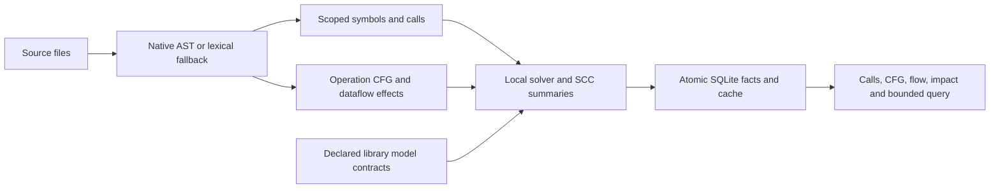

# cxt architecture

Updated: 2026-09-27. Source of implementation scope and evidence:
[static analysis roadmap](docs/STATIC_ANALYSIS_ROADMAP.md).

## Entry points and storage

- `src/cli.ts`: Commander commands, parser/output policy and asynchronous error boundary.
- `src/cli/`: scan, BS, audit, entity/graph/flow/impact/query handlers. Handlers emit text, JSON or SARIF; scan/BS/audit outcome uses the shared reporting contract.
- `src/index.ts`: public package API. `dist` is produced by TypeScript plus copied `.scm` assets; npm tarball installation is checked separately from source tests.
- `src/registry/sqliteStore.ts`: SQLite migrations, entity annotations/FTS, project isolation and transactional fact snapshots. Default DB is `~/.cxt/registry.db`; tests and measurements use isolated databases.
- `src/registry/entityScanner.ts`: source walking, test mapping, frontend/cache orchestration, call resolution and atomic snapshot publication. `ignoreRules.ts` combines built-in exclusions, `.gitignore` and `.cxtignore`.

## Semantic extraction

- `src/frontend/`: native parser loader, TS/JS/Python/Rust declaration queries, source ranges, binding facts, structured control lowering and dataflow effects. Syntax/query errors fail scan; unavailable native modules permit an explicit partial lexical fallback in auto mode.
- `src/analysis/resolveSymbols.ts` and `symbols.ts`: lexical binding/import/alias/re-export and limited receiver resolution. Unresolved/external calls retain location and reason; they do not invent target edges.
- `cfg.ts`, `dataflowTypes.ts`, `dataflow.ts`: CFG contracts and finite intraprocedural worklist. Values carry definitions, parameter dependence and limited allocation/field aliases. Unknown effects havoc affected abstract state. Transfer/state/work budgets produce partial results.
- `summaries.ts`, `summaryTypes.ts`: callee-first SCC fixed point and call-site argument substitution. Recursive components are bounded. Unknown/partial summaries remain conservative.
- `libraryModels.ts`: versioned conditional contracts and provenance. Project-declared target versions and assumptions are required; undeclared or rejected external behavior stays unknown.
- `parameterImpact.ts`: current explicit parameter-value dependence into caller outputs. It does not model arbitrary future behavior or implicit control dependence.

## Rules and reporting

`bsDetector.ts` reads source directly. AST structural predicates (`astRules.ts`) and completed-local-flow diagnostics (`semanticRules.ts`) use rule contracts/path roles in `rulePack.ts`. Unsupported languages use the existing lexical fallback with diagnostics. This path is independent of the persisted fact cache.

`report.ts` defines complete/findings/partial/failed outcomes. `sarif.ts` produces SARIF 2.1.0 locations, fingerprints, rule metadata and definition/read endpoint evidence. Full runtime traces are not inferred from these endpoints. See [rule contracts](docs/STRUCTURAL_RULES.md) and [report contracts](docs/ANALYSIS_REPORTS.md).

## Snapshot and query boundaries

DB v9 stores entities/relations/calls/CFG/local flows/summaries/model manifests plus derived frontend/SCC caches. File content and engine/parser identity control frontend reuse. Current imports are always re-resolved. Linked CFGs, callee summaries and model manifests control SCC reuse. Facts and cache changes share a transaction; errors roll back the snapshot.

`cache.ts` defines hashes/serialization. `factQuery.ts` accepts bounded structured filters over five allowlisted SQL views; it exposes no arbitrary SQL. Query results identify themselves as persisted snapshots with freshness unverified. Engine files must remain unchanged for the life of a process. See [incremental contracts](docs/INCREMENTAL_FACTS.md).

## Verification and remaining scope

- `tests/`: semantic, failure/rollback, migration, reporting and CLI contracts; official SARIF schema is pinned under `tests/schemas/`.
- `bench/`: labeled development corpora and precision/recall/span/coverage gates; cold/warm snapshot equivalence and process measurements. These are not proof of CodeQL parity. Independent real-world/held-out validation remains tracked in the roadmap.
- `scripts/test-packed-frontends.mjs`: real tarball install, native availability/fallback, scan/query/flow/reporting CLI behavior.
- `testing/`: separate agent behavior benchmark harness.

Full type/package dispatch, dynamic framework behavior, resource lifecycles, Rust ownership and broader language semantics remain incomplete. Security taint/CWE expansion is outside the current epic scope. A successful snapshot commit does not imply semantic completeness or program safety.
